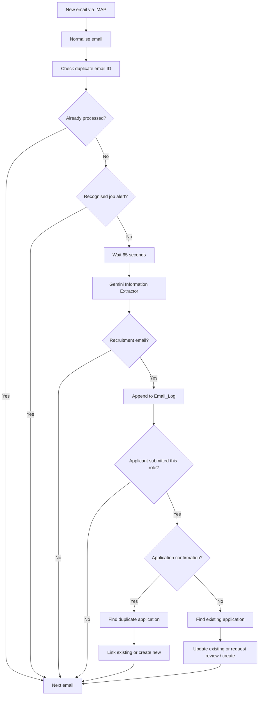

# AI Graduate Application Tracker

**An automated recruitment-email processing pipeline built using n8n, Google Gemini, IMAP, Google Sheets and Docker.**

Instead of manually updating a spreadsheet after every application confirmation, assessment invitation, interview or rejection, this workflow reads incoming recruitment emails, extracts structured information with AI and keeps an application tracker up to date.

> **Portfolio / demonstration repository.** The workflow export has been sanitised. It does **not** include credentials, a live spreadsheet, or real recruitment emails. Importing it requires your own accounts and configuration.

## What it does

- **Ingests new emails** from a dedicated inbox using an IMAP trigger.
- **Normalises email content** (sender, subject, timestamp, body) for consistent processing.
- **Skips common job alerts** before calling AI, reducing unnecessary requests.
- **Checks for already-logged email IDs** to avoid processing the same email twice.
- **Classifies recruitment emails with Gemini** and extracts company, role, application stage and confidence.
- **Checks for existing applications** using a normalised company-and-role match key.
- **Creates or updates application records** in Google Sheets and links each recruitment email to its application.
- **Routes uncertain or incomplete records** to a `Needs_Review` sheet.
- **Uses a 65-second Wait node and 5 retry attempts** to reduce the impact of some API limits and temporary errors (not a guarantee of recovery).

## Workflow overview



The diagram simplifies the detailed branches in the exported workflow.

## Technology stack

| Technology | Role |
| --- | --- |
| **n8n** | Low-code workflow orchestration and conditional logic |
| **IMAP** | Detect incoming recruitment emails |
| **Google Gemini** | Extract structured information and classify messages |
| **Google Sheets** | Persist application records, email history and review queue |
| **Docker** | Run n8n locally with a persistent data volume |
| **JavaScript expressions** | Normalisation, matching keys and filtering |

## Repository contents

```text
ai-graduate-application-tracker/
├── README.md
├── .gitignore
├── workflows/
│   └── job-application-tracker.template.json
├── samples/
│   └── example-records.json
└── docs/
    ├── ARCHITECTURE.md
    └── SECURITY.md
```

## Setup (your own instance)

1. **Run n8n**, for example through Docker, with a persistent volume. The source workflow was exported from n8n **2.44.5**; compatibility with other versions has not been verified.
2. **Import** `workflows/job-application-tracker.template.json` into n8n. It is intentionally **inactive** and cannot be published successfully before credentials and data destinations are configured.
3. **Create and assign credentials** for the IMAP mailbox, Google Gemini API and Google Sheets service account. No credentials are shipped here.
4. **Create a Google spreadsheet** with tabs named `Applications`, `Email_Log`, and `Needs_Review` using the fields documented in [ARCHITECTURE.md](docs/ARCHITECTURE.md).
5. **Re-select your spreadsheet ID and the correct tab** in *every* Google Sheets node. The provided sheet ID values and tab selections are deliberately blank/placeholder. Ensure your service account can edit the spreadsheet.
6. **Review the Gemini model and API quota** for your account, then select the matching model in the `Google Gemini Chat Model` node.
7. **Review all branches and settings**, then publish the workflow in your n8n instance. Test with clearly fictional emails before relying on it for real applications.
8. **Configure error notifications separately** if desired. The author's separate error-alert workflow is not included in this export.

### Demo data

`samples/example-records.json` contains **fictional** examples of records in the three tabs. It is safe to use for screenshots or documentation. No real recruitment data is included.

## Engineering lessons

- **Idempotency:** Check email IDs before creating any new log rows.
- **Entity matching:** Normalise company and job-title strings to avoid duplicate application rows for minor title variations.
- **Human review:** Route ambiguous or low-confidence information for manual validation rather than inventing details.
- **Operational resilience:** Add retries, job-ad filtering, saved executions and separate failure notifications.
- **Debugging in production:** Differentiate API rate limits (`429`) from upstream service unavailability (`503`).

## Known limitations

- **LLM calls may still fail** due to API quotas, `429` limits or `503` outages; a timed Wait and short retries do not guarantee delivery. Failed production executions need monitoring and sometimes manual recovery.
- **Parallel executions and Wait nodes** may still cause bursts of API requests. A shared rate limiter or queue would improve this further.
- **Matching is heuristic:** A normalised company/title pair can incorrectly merge similarly titled roles or miss roles with substantially different wording.
- **Status updates are not fully regression-proof** in this exported workflow: later, lower-stage messages may overwrite higher-stage statuses. A status-ranking guard is a planned improvement.
- **Local hosting requires uptime:** The host computer and Docker container must remain operational for automatic processing.
- The **SQL analytics/dashboard stage is planned**, not part of this exported n8n workflow.

## Roadmap

- [ ] Add a robust dead-letter/recovery queue for emails that fail after retries
- [ ] Add rate limiting shared across workflow executions
- [ ] Protect application statuses from backwards transitions
- [ ] Add PostgreSQL/SQL analytics for application funnels and conversion rates
- [ ] Build a reporting dashboard and publish anonymised screenshots

## Privacy and responsible sharing

Only fictional example records are included. **Never commit** real recruitment emails, candidate records, API keys, service-account JSON credentials, OAuth tokens, Docker's `.n8n` folder or the `n8n_data` volume. See [SECURITY.md](docs/SECURITY.md).

## Project status

The original personal deployment successfully completed an end-to-end test (IMAP → Gemini → Google Sheets). This repository is an **independent, sanitised example** of the workflow, not a hosted service or a guarantee of error-free operation.
